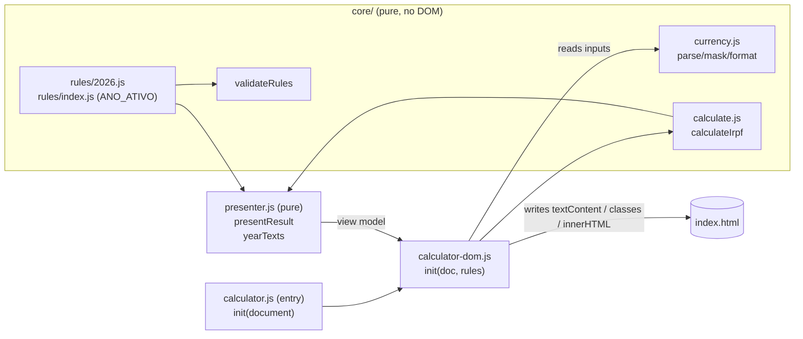

# Rules Engine Refactor Design

**Spec**: `.specs/features/rules-engine-refactor/spec.md`
**Status**: Approved 2026-11-12 - user chose "A: ESM in public/ (Recommended)"

---

## Approaches considered

| # | Approach | Trade-off | Verdict |
|---|----------|-----------|---------|
| A | Core as **native ES modules under `public/scripts/`**, loaded with `<script type="module">`. Vitest imports the same files. | No build step and the deploy is unchanged. The core moves to `src/` in the future TS/framework migration (a rename). | **Recommended** |
| B | Core in `src/core/`, bundled by webpack into a second committed bundle (`public/calculator.bundle.js`) | Code sits in its "final" place, but every edit needs a build, a generated file gets committed, and webpack's `watch: true` blocks one-shot builds | Rejected |
| C | Core in `src/core/` and switch to Vite now | Ahead of the agreed scope ("JSDoc + type-check" decision) | Rejected |

## Architecture Overview

Three layers. Only the outer one touches the DOM. Every rule that changes what the user sees (numbers, clamping to R$ 0,00, the obrigatória decision, result text, CSS classes, year texts) runs in the core or the presenter. The tests reach both.



Flow for each `input` event: mask the target → `readInputs(doc)` → `calculateIrpf(inputs, rules)` → `presentResult(result, rules)` → write the view model into the DOM.
On load: `yearTexts(rules)` → fill every `[data-rule]`.

---

## Code Reuse Analysis

### Existing Components to Leverage

| Component | Location | How to Use |
|-----------|----------|------------|
| Money mask | `public/scripts/calculator.js:15-21` (`masks.money`) | Moves into `core/currency.js` unchanged |
| Calculation + display logic | `public/scripts/calculator.js:23-130` | Split into `calculateIrpf` (math) and `presentResult` (strings, classes). The same expressions in the same order, so float results match bit for bit |
| Result texts | `calculator.js:118-128` | Copied character for character into the presenter, with `R$ 35.584,00` replaced by the formatted limit |
| Legacy script (commit `7b33eee`) | `git show 7b33eee:public/scripts/calculator.js` | Frozen as `tests/fixtures/calculator.legacy.js`. It's the golden master for UI-01..03 |
| `accordion.js` | `public/scripts/accordion.js` | Untouched |

### Integration Points

| System | Integration Method |
|--------|--------------------|
| index.html | `<script src="/scripts/calculator.js" defer>` → `<script type="module" src="/scripts/calculator.js">`. Year-dependent text wrapped in `<span data-rule="…">current value</span>` |
| Firebase Hosting | No change. It serves `.js` as JavaScript, which module scripts need |
| webpack / bundle.js | No change |

---

## Components

### `core/rules/<fiscalYear>.js` + `core/rules/index.js`
- **Purpose**: One fiscal year's (exercício) rules as data, plus the active-year switch.
- **Location**: `public/scripts/core/rules/`
- **Interfaces**:
  - `export const rules2026: YearRules`
  - `export const rulesByFiscalYear: Record<number, YearRules>`
  - `export const ACTIVE_FISCAL_YEAR = 2026`
  - `export const activeRules: YearRules`
- **Dependencies**: none

### `core/validateRules.js`
- **Purpose**: Reject a malformed year config (RULES-04).
- **Interfaces**: `validateRules(rules: unknown): asserts rules is YearRules`. Throws `Error("invalid rules: <field> …")`.
- **Called from**: tests only (RULES-05 iterates `rulesByFiscalYear`). Not at runtime: a bad config fails `npm test` before deploy, and users never see a thrown error.

### `core/currency.js`
- **Purpose**: Parse and format money in pt-BR.
- **Interfaces**:
  - `parseBRL(valor: string): number`. Strips non-digits and divides by 100 (CALC-07). Same expression as today.
  - `maskBRL(valor: string): string`. Returns e.g. `"R$ 123,45"`, with the NBSP that Intl outputs, as today (CALC-08).
  - `formatBRL(n: number): string`. Intl currency, as the result boxes do today.
  - `formatNumber(n: number): string`. Intl plain pt-BR, as the `#conta-*` spans do today.
  - `formatLimit(n: number): string`. `formatBRL` with NBSP replaced by a regular space, matching the hand-typed `"R$ 35.584,00"` in today's HTML and result text.
  - `formatRate(t: number): {percentual: string, decimal: string}`. 0.32 → `"32%"` and `"0,32"`.

### `core/calculate.js`
- **Purpose**: The IRPF rules (CALC-01..05, RULES-03).
- **Interfaces**: `calculateIrpf(inputs: Inputs, rules: YearRules): Result`
- **Rule**: receita = s + c + t. apurado = receita − despesas (not clamped). isento = s·taxa.serviços + c·taxa.comércio + t·taxa.transporte. tributável = apurado − isento. obrigatória = tributável > limite. These are today's expressions, in today's order.

### `presenter.js`
- **Purpose**: Turn a `Result` into exactly the strings and classes the page shows (UI-01..03, UI-07). Turn `YearRules` into the year texts (UI-04..06).
- **Location**: `public/scripts/presenter.js`
- **Interfaces**:
  - `presentResult(result: Result, rules: YearRules): ResultView`
  - `yearTexts(rules: YearRules): Record<RuleKey, string>`
- **Behaviour kept from today**: `#lucro-apurado` shows "R$ 0,00" when apurado < 0. `#lucro-tributável` shows "R$ 0,00" when tributável ≤ 0. `#conta-lucro-apurado` shows the unclamped apurado. The result text goes into `innerHTML`, with today's `<b>` and whitespace.

### `calculator-dom.js` (adapter) + `calculator.js` (entry)
- **Purpose**: The only code that touches the DOM.
- **Interfaces**: `init(doc: Document, rules: YearRules = activeRules): void`. It fills `[data-rule]` (text, plus `href` for `legalReferenceUrl`) and binds the `input` listeners. `calculator.js` is just `init(document)`.
- **Writes `textContent`** where today's code wrote `innerText`. For these plain-text elements the visible result is the same, and jsdom supports `textContent`.

---

## Data Models

```ts
// JSDoc typedefs in public/scripts/core/types.js — shown as TS for readability
interface YearRules {
  fiscalYear: number            // exercício, 2026
  calendarYear: number          // ano-calendário, 2025
  taxableIncomeLimit: number    // limite de rendimento tributável, 35584
  presumedProfitRates: { services: number; commerce: number; transport: number } // 0.32, 0.08, 0.16
  lastUpdated: string           // "2026-11-09" (ISO); shown as 09/11/2026
  legalReference: { name: string; url: string } // "IN RFB Nº 2.312/2026"
  otherObligations: { exemptIncome: number; stockTrading: number; ruralRevenue: number; assets: number } // 200000, 40000, 177920, 800000 (RULES-07)
}
interface Inputs { services: number; commerce: number; transport: number; expenses: number } // serviços, comércio, transporte, despesas
interface Result {
  grossRevenue: number   // receita bruta
  netProfit: number      // lucro apurado (unclamped)
  exemptIncome: number   // lucro / rendimento isento
  taxableIncome: number  // lucro / rendimento tributável
  mustDeclare: boolean   // declaração obrigatória
  inputs: Inputs
}
interface ResultView {
  texts: Record<string, string>   // element id (existing pt-BR ids, e.g. "lucro-apurado") → textContent
  taxableIncomeRed: boolean
  title: { text: string; className: 'red' | 'green' }
  resultHtml: string
}
type RuleKey = 'calendarYear' | 'fiscalYear' | 'lastUpdated' | 'legalReferenceName'
  | 'legalReferenceUrl' | 'limit' | 'servicesRatePercent' | 'servicesRateDecimal' | … // one per placeholder kind
```

---

## Tests

| File | Covers | Environment |
|------|--------|-------------|
| `tests/core/calculate.test.js` | CALC-01..05, RULES-03 | node |
| `tests/core/currency.test.js` | CALC-07, CALC-08 | node |
| `tests/core/rules.test.js` | RULES-01, 02, 04, 05, 06 | node |
| `tests/core/purity.test.js` | CALC-06, TS-03 (static scan for `document`/`window` + import has no side effects) | node |
| `tests/presenter.test.js` | UI-02, UI-03, UI-07, CALC-05 view | node |
| `tests/html-rules.test.js` | UI-05 (static `[data-rule]` text = `yearTexts(activeRules)`; no bare year values left outside placeholders) | node + jsdom parser |
| `tests/dom.test.js` | UI-01 golden master (legacy script vs new adapter in two JSDOM windows, about 200 input sets incl. boundary/negative/huge), UI-04, UI-06 | jsdom |

Typecheck: `tsconfig.json` with `allowJs`, `checkJs`, `noEmit`, `strict`, `lib: ["ES2022"]` (no DOM lib, so a DOM reference in the core fails to compile), `include` limited to `public/scripts/core/**` and `public/scripts/presenter.js` (TS-02).

---

## Error Handling Strategy

| Error Scenario | Handling | User Impact |
|----------------|----------|-------------|
| Malformed year config | `validateRules` throws in `npm test` | None. It's caught before deploy |
| Non-digit input | Stripped by `parseBRL` / `maskBRL` | Same as today |
| Browser without ES modules | Not handled (all supported browsers have had modules since 2018) | Calculator inert. Accepted |
| JS disabled | Static HTML keeps the current values | Year texts still correct |

---

## Risks & Concerns

| Concern | Location | Impact | Mitigation |
|---------|----------|--------|------------|
| jsdom doesn't implement `innerText` | legacy `calculator.js` | The golden master would read empty strings for the legacy run | The test defines an `innerText` accessor backed by `textContent` in the legacy window only |
| Intl puts NBSP in currency output, while the HTML uses a regular space | `index.html:213,228,262`, `calculator.js:122` | The UI-05 comparison fails, or the result text changes by one character | `formatLimit` replaces NBSP with a space. The golden master compares raw strings |
| Float math (e.g. 0.32 × value) | `calculator.js:68-72` | — | Same expressions in the same order. The golden master proves bit-identical output. The cents fix is deferred |
| The "outras obrigações" list hard-codes yearly limits (R$ 200.000, R$ 40.000, R$ 177.920, R$ 800.000) | `index.html:251-254` | The yearly update still needs edits outside the config, which breaks Success Criterion 1 | Moved into config (RULES-07) - user: "Yes, add to config (Recommended)" |
| Module script runs deferred like before, but is a module | `index.html:25` | Load order relative to `bundle.js` changes slightly | The two scripts are independent. No impact |
| `node_modules/` tracked (7,611 files) | git index | Adding Vitest/jsdom/TS would add thousands of files | First task untracks it (approved) |
| `npm run build` never exits (`watch: true`) | `webpack.config.js` | — | Out of scope (spec assumption) |

---

## Tech Decisions

| Decision | Choice | Rationale |
|----------|--------|-----------|
| Module format | Native ESM, no bundler for app code | Approach A |
| Test runner | Vitest + jsdom | ESM-native. Carries over to the future Vite/framework setup |
| Typing | JSDoc + `tsc --noEmit`, no DOM lib for the core | User decision. The missing DOM lib enforces CALC-06 at compile time too |
| Golden master | Legacy script frozen in `tests/fixtures/` | Turns "pure refactor" into a test instead of a promise |
| Config runtime validation | Tests only | A user never sees a config error |
| Language | English for every JS identifier, file name, comment, test title and the new `data-rule` keys. pt-BR stays for user-facing text and the existing HTML ids/CSS classes. A pt-BR ↔ EN glossary goes in CLAUDE.md | User decisions 2026-11-13 (AD-004) |

Project-level decisions (AD-001..004: ESM core under `public/scripts/core`, Vitest + jsdom, one `rules/<fiscalYear>.js` per year) go to `.specs/STATE.md` when the design is approved.

## Glossary (code ↔ Receita Federal)

| Code | pt-BR |
|------|-------|
| fiscalYear | exercício |
| calendarYear | ano-calendário |
| grossRevenue | receita bruta |
| expenses | despesas |
| netProfit | lucro apurado |
| exemptIncome | rendimento (lucro) isento |
| taxableIncome | rendimento (lucro) tributável |
| taxableIncomeLimit | limite de rendimento tributável |
| presumedProfitRates | percentuais de presunção |
| services / commerce / transport | serviços / comércio, indústria e transporte de cargas / transporte de passageiros |
| mustDeclare | declaração obrigatória |
| otherObligations | outras hipóteses de obrigatoriedade |
